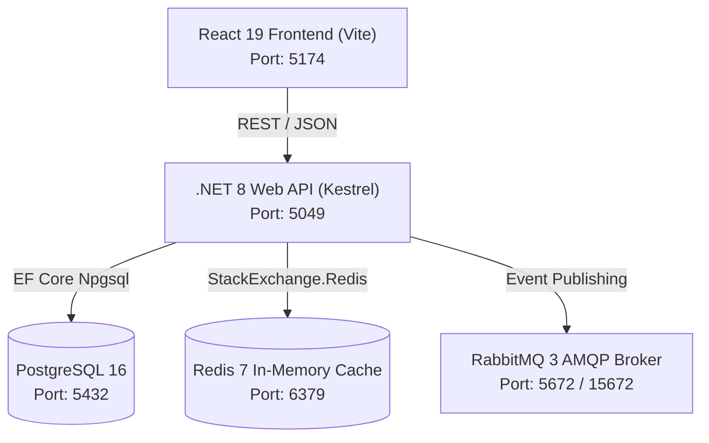

# MediVault — Personal Medical Information & Prescription System

MediVault is a full-stack, enterprise-grade personal health record organizer designed with **Serene Clinical Minimalism**, strict privacy compliance, and offline-first persistence. 

> [!IMPORTANT]
> **Medical Disclaimer & Regulatory Boundary**: MediVault is strictly an informational record organizer and intake tracker. It does **not** provide medical advice, diagnosis, treatment evaluations, or dosage modifications. Users should always consult a licensed physician or healthcare provider.

---

## 🏛️ System Architecture



---

## 📦 Technology Stack

### Frontend (`client/`)
* **Framework**: React 19 + Vite
* **Styling**: Vanilla CSS with customized design tokens (`index.css`, `App.css`)
* **Typography**: Google Fonts (*Plus Jakarta Sans* & *Inter*) + *Material Symbols Outlined*
* **State & Persistence**: Offline-first storage utility with `localStorage` fallback
* **Build & Linting**: Vite Production Bundler (142ms build) + `oxlint` (0 Warnings, 0 Errors)

### Backend (`server/`)
* **Framework**: .NET 8 (ASP.NET Core Web API)
* **Architecture**: Clean Repository & Service Pattern
* **ORM**: Entity Framework Core 8 with Code-First Migrations
* **Caching**: Redis 7 Distributed Cache with 5-minute sliding expiration & invalidation
* **Messaging**: RabbitMQ Event Bus for dose intake state transitions
* **API Documentation**: Swagger / OpenAPI UI (`/swagger`)

### Infrastructure (`docker-compose.yml`)
* **PostgreSQL 16**: Relational health ledger (`medivault_postgres`)
* **Redis 7 Alpine**: Distributed memory cache (`medivault_redis`)
* **RabbitMQ 3 Management**: Event broker & administrative dashboard (`medivault_rabbitmq`)

---

## 🚀 Getting Started

### 1. Prerequisites
* [Docker Desktop](https://www.docker.com/products/docker-desktop/)
* [.NET 8 SDK](https://dotnet.microsoft.com/download/dotnet/8.0)
* [Node.js (v18+)](https://nodejs.org/)

### 2. Launch Infrastructure
Start PostgreSQL, Redis, and RabbitMQ:
```bash
docker compose up -d
```

### 3. Run Backend API
```bash
dotnet run --project server/MediVault.Server.csproj --urls "http://localhost:5049"
```
* **API URL**: `http://localhost:5049`
* **Swagger UI**: `http://localhost:5049/swagger`

### 4. Run Frontend Client
```bash
cd client
npm install
npm run dev
```
* **Application URL**: `http://localhost:5174` (or `http://localhost:5173`)

---

## 📑 Feature Modules & Screens

1. **Public Landing Page** (`/pages/LandingPage.jsx`): Hero value proposition, feature grid, and regulatory notices.
2. **Authentication Flow** (`/components/AuthModal.jsx`): Sign In, Sign Up with live password strength meter, 1-click Demo Account access.
3. **Overview Dashboard** (`/pages/Dashboard.jsx`): Adherence metrics, daily schedule progress, and interactive Take/Skip/Snooze controls.
4. **Medications Directory** (`/pages/Medications.jsx`): Regimen search, filter by frequency, active status cards.
5. **Daily Schedule** (`/pages/Schedule.jsx`): Routine time blocks (Morning, Afternoon, Evening) with adherence streaks.
6. **Prescriptions Library** (`/pages/Prescriptions.jsx`): Digital slips archive, verification tags, and physician metrics.
7. **Prescription OCR Wizard** (`/components/UploadPrescriptionModal.jsx`): 3-step file drop, simulated scanning animation, and verified form sync.
8. **History & Intake Logs** (`/pages/History.jsx`): Chronological stream, search filters, and in-browser CSV report export.
9. **Reminders & Alarms** (`/pages/Reminders.jsx`): Multi-channel alert dispatchers with simulated live alarm banners.
10. **Family Care Circles** (`/pages/FamilyProfiles.jsx`): Vault switching for dependents (self, parents, children).
11. **Settings & Governance** (`/pages/Settings.jsx`): Account profile, notification preferences, recognized sessions, and full JSON archive export.
12. **Global Omnisearch (`⌘K`)** (`/components/GlobalSearchModal.jsx`): Multi-index keyboard search across medications, documents, and family profiles.
13. **Emergency Medical Wallet Card** (`/components/EmergencyCardModal.jsx`): High-visibility emergency medical summary with foldable print layout (`@media print`).

---

## 📡 REST API Reference

| Method | Endpoint | Description |
| :--- | :--- | :--- |
| `GET` | `/api/medications` | Fetch all registered medications |
| `POST` | `/api/medications` | Register a new medication regimen |
| `GET` | `/api/doses/today` | Fetch today's dose logs (Redis cached) |
| `PATCH` | `/api/doses/{id}/status` | Update intake status (`Taken`, `Skipped`) |
| `GET` | `/api/prescriptions` | Fetch prescription records |
| `POST` | `/api/prescriptions` | Upload/add verified prescription record |
| `DELETE` | `/api/prescriptions/{id}` | Remove prescription record |
| `GET` | `/api/family` | Fetch care circle family profiles |
| `POST` | `/api/family` | Add family member profile |
| `DELETE` | `/api/family/{id}` | Remove family member profile |

---

## 🔒 Security & Privacy Practices
* **Zero Monetization**: No advertising scripts, analytics beacons, or data broker integrations.
* **Encrypted Boundaries**: Personal logs and sensitive records isolated with profile identifiers.
* **Offline-First Resilience**: Full in-browser fallback so critical medication schedules remain viewable even without internet connectivity.
